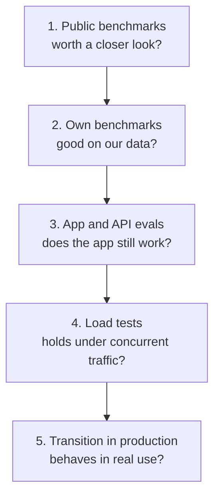

# Evaluation layers

We test in five layers. Each layer answers one question and has its own code or process. No layer decides alone.

| Layer | Question it answers | Where |
|---|---|---|
| 1. Public benchmarks | Is this model worth a closer look? | External benchmarks and leaderboards, listed in [selection-standard.md](selection-standard.md) |
| 2. Own benchmarks | How good is it on our kind of data? | This repository: [`stt/`](../stt/README.md), [`ocr/`](../ocr/README.md), [`tts/`](../tts/README.md). [`pii-ner/`](../pii-ner/README.md) and [`decision-models/`](../decision-models/README.md) join later |
| 3. App and API evals | Does the app or API still behave correctly with it? | See the list below |
| 4. Load tests | Does it hold up under real concurrent traffic on the live API? | [`vllm-benchmark`](https://github.com/DCC-BS/vllm-benchmark) and the load tests in [`bentoml-faster-whisper`](https://github.com/DCC-BS/bentoml-faster-whisper) |
| 5. Transition in production | Does it behave in real use? | A process, described in [lifecycle.md](lifecycle.md) |

## Layer 3: app and API suites

- [`bentoml-faster-whisper`](https://github.com/DCC-BS/bentoml-faster-whisper): unit, integration and performance tests for transcription and diarization.
- [`dcc-docling-serve/benchmarks`](https://github.com/DCC-BS/dcc-docling-serve/tree/main/benchmarks): document conversion benchmarks, with synthetic PDFs.
- [`text-mate-backend/evals`](https://github.com/DCC-BS/text-mate-backend/tree/main/evals): evals for the advisor and simplify features.
- [`transcribo-backend`](https://github.com/DCC-BS/transcribo-backend) and [`bs-translator-backend`](https://github.com/DCC-BS/bs-translator-backend): route, service and integration tests, including tests against a live model.
- [`deep-research-evaluation`](https://github.com/DCC-BS/deep-research-evaluation): evaluation of the deep-research engine.

## What the layers do not cover

- Layer 1 numbers come from other people's data. They tell us where to look, not what to run.
- Layer 2 uses our own data, which is private. The method is public, the data and results are not. See [data-policy.md](data-policy.md).
- TTS has no automated metric. Layer 2 for TTS is a listening protocol.
- Layer 5 is a process, not code. We keep records of it in the [decision record](decision-record-template.md).
