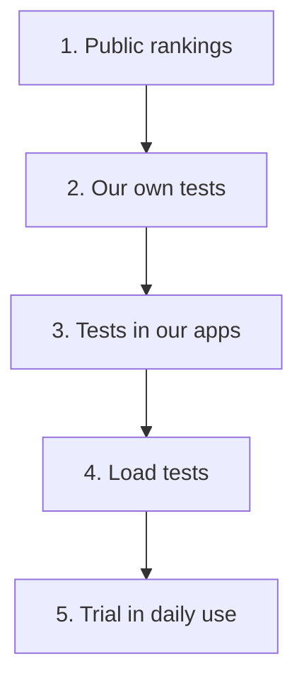

# How we test

We test every model in five rounds. Each round answers one question and has its own code or process. A model has to do well in all of them.

| Round | Question | Where |
|---|---|---|
| 1. Public rankings | Is this model worth a closer look? | Public tests and rankings, listed in [selection-standard.md](selection-standard.md) |
| 2. Our own tests | How well does it handle material like ours? | This repository: [`stt/`](../stt/README.md), [`ocr/`](../ocr/README.md), [`tts/`](../tts/README.md). [`pii-ner/`](../pii-ner/README.md) and [`decision-models/`](../decision-models/README.md) will follow |
| 3. Tests in our apps | Do our apps and APIs still work correctly with it? | See the list below |
| 4. Load tests | Does it stay fast when many people use the live service at once? | [`vllm-benchmark`](https://github.com/DCC-BS/vllm-benchmark) and the load tests in [`bentoml-faster-whisper`](https://github.com/DCC-BS/bentoml-faster-whisper) |
| 5. Trial in daily use | How does it behave in real work? | A process, described in [lifecycle.md](lifecycle.md) |

## Round 3: tests in our apps

- [`bentoml-faster-whisper`](https://github.com/DCC-BS/bentoml-faster-whisper) has unit, integration and performance tests for transcription and for telling speakers apart (diarization).
- [`dcc-docling-serve/benchmarks`](https://github.com/DCC-BS/dcc-docling-serve/tree/main/benchmarks) tests document conversion with made-up PDFs.
- [`text-mate-backend/evals`](https://github.com/DCC-BS/text-mate-backend/tree/main/evals) tests the advice and simplification features of TextMate.
- [`transcribo-backend`](https://github.com/DCC-BS/transcribo-backend) and [`bs-translator-backend`](https://github.com/DCC-BS/bs-translator-backend) have route, service and integration tests. Some of them run against a live model.
- [`deep-research-evaluation`](https://github.com/DCC-BS/deep-research-evaluation) tests the research assistant in Bebbi Bot.

## What these rounds can't show

- Round 1 results come from other people's data. They help us find candidates, and we decide based on the later rounds.
- Round 2 runs on our own data, which stays private. You can run the same code on your data, but you won't get our numbers. See [data-policy.md](data-policy.md).
- For synthetic voices there is no automatic score. Round 2 for TTS is a listening checklist.
- Round 5 has no test code. People watch how the model does in daily work, and we write it down in the [decision record](decision-record-template.md).
